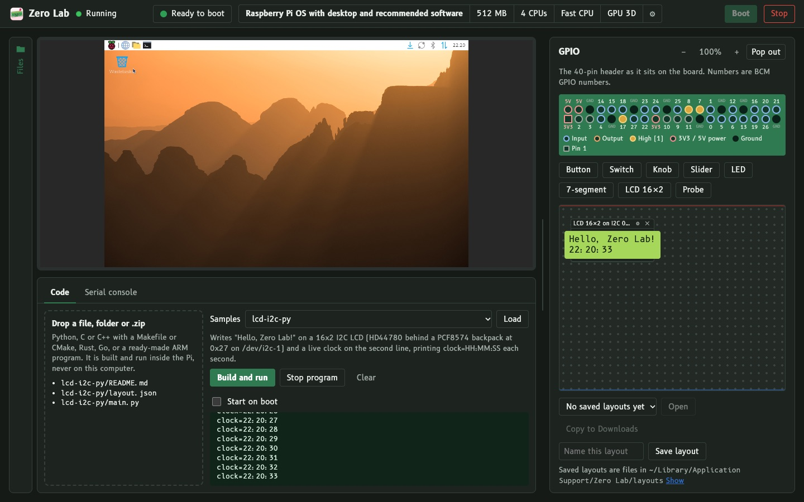
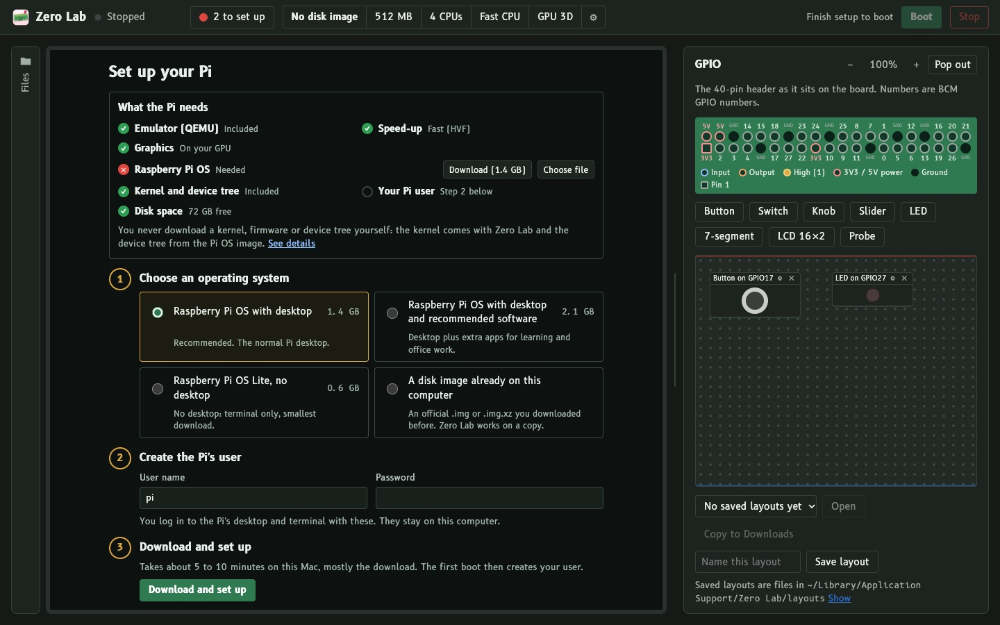

# Zero Lab

A friendly app around an emulated **Raspberry Pi Zero 2 W**. Boot Raspberry Pi OS, use its desktop, wire virtual buttons, switches, knobs, LEDs and 7-segment displays to its GPIO pins, move files in and out, and drop in your own code to build and run on the Pi.

Zero Lab runs on **[qemu-raspi-zero2w](https://github.com/dsellerbrock/qemu-raspi-zero2w)**, our QEMU fork with:
- external GPIO with edge interrupts for the BCM2835;
- virtio-gpu and virtio-blk on the `raspi3ap` board;
- Apple Hypervisor (HVF) support, using a 4 KiB IPA granule;
- Venus (Vulkan) graphics through MoltenVK/Metal.





## Get it
- **macOS** (Apple Silicon, 26+): `Zero-Lab-<version>-macOS-arm64.dmg`. CPU runs on HVF; graphics are Venus (Vulkan via Metal).
- **Linux** (x86_64, Ubuntu 22.04 or newer, or the same age): `Zero-Lab-<version>-linux-x86_64.AppImage`. Mark it executable and double-click it; nothing to compile, no root. The CPU is emulated (TCG); graphics are software, or virgl/Venus where a GPU render node exists. Other CPUs or older distributions: build from source with `linux/setup.sh` ([docs/BUILDING.md](docs/BUILDING.md)).
- **Windows 10/11 x64**: `Zero-Lab-<version>-windows-x64-setup.exe`. It's a per-user install wizard: no admin, no WSL. It adds Start-menu and desktop shortcuts, and its uninstaller keeps your Pi data. Zero Lab opens in its own maximised window (Edge's app mode, which is part of Windows), and closing that window shuts the Pi down and ends every Zero Lab process. QEMU is cross-built with mingw-w64, and Python comes with it. The CPU is emulated (TCG) and graphics are software, as they'd be under WSL. The GPL sources are in `…-windows-x64-sources.zip`.

Downloads: https://pisim.ellerbrock.dev. Instructions for friends: [docs/FRIENDS.md](docs/FRIENDS.md).

## What's in the window
- **First run.** A checklist shows what the Pi needs (emulator, speed-up, graphics, Raspberry Pi OS, user, disk space), and three steps download and set up the official image. No Pi firmware is needed. Zero Lab ships the Pi OS kernel rebuilt with virtio built in (screen and fast disk; recipe in [kernel/](kernel)), and the device tree comes from the image.
- **The Pi's screen**, through noVNC over QEMU's VNC websocket.
- **GPIO breadboard.** A 40-pin header shown by physical position, plus parts you can drag onto it: buttons, switches, knobs and sliders (as GPIO bits or through an emulated MCP3008 ADC on SPI0), LEDs, a 7-segment display (on GPIO pins or an HT16K33 on I2C), a 16×2 LCD (I2C) and a probe. Zoom in and out, or pop it out into its own window. Layouts save as JSON in `~/Library/Application Support/Zero Lab/layouts` (Linux: `~/.local/share/zero-lab/layouts`, Windows: `%LOCALAPPDATA%\Zero Lab\layouts`).
- **Files sidebar.** Browse the Pi's file system; drop files in; download files and folders to `~/Downloads`.
- **Your code.** Drop Python, C/C++ (Makefile/CMake), Rust, Go or an ARM binary. It is built and run inside the Pi, never on your computer. The [samples](samples) cover each GPIO part: button-led (Python and C), switch, knob, analog knob (the emulated MCP3008 ADC on SPI0), 7-segment, 7-segment and LCD 16×2 over I2C (emulated HT16K33 and PCF8574 backpacks), probe and LED blink.
- **Settings** in a drawer (memory, cores, speed-up, graphics, screen, internet, throw-away mode), each with an explanation.

## Build from source
Everything builds from this repository; every input is pinned in [`tools/pins.sh`](tools/pins.sh). The full guide is [docs/BUILDING.md](docs/BUILDING.md): the kernel, the macOS dmg, the Linux AppImage, the Linux/WSL zip, GPL sources, testing and releasing. CI builds every download: Actions → **Build installers**.

```bash
git clone https://github.com/dsellerbrock/zero-lab.git
```

```bash
cd zero-lab && kernel/build.sh && mac/build-bundle.sh all
```

**Run from a checkout** against any build of the fork:

```bash
ZL_QEMU_DIR=/path/to/qemu/prefix python3 app/server.py --open
```

**Tests:**

```bash
python3 -m unittest discover -s tests
```

`tests/e2e.py` drives a real boot through the same API the UI uses: image setup, boot, Files, and every GPIO sample.

## Layout
```
app/            server.py (stdlib HTTP + SSE + VNC websocket pipe), vm.py (QEMU args, QMP, serial),
                gpio.py (QTest, GPIO registers only), image.py (download, verify, provision), fdt.py (DTB editor),
                guest.py (SSH: code + files), readiness.py, guest/ (scripts that run inside the Pi),
                static/ (UI, vendored noVNC and B612 fonts)
mac/            ZeroLab.swift (window), build-bundle.sh (deps -> qemu -> app -> dmg), relocate.py
linux/ windows/ installers; windows/installer.nsi (Windows install wizard)
samples/        one program + layout per GPIO part
kernel/         build.sh + config for the Pi kernel (Pi OS 6.18.50 with virtio built in)
tools/          pins.sh (every pinned input), source-bundle.sh (GPL sources), make-appimage.sh,
                make-windows-installer.sh, shoot.mjs (screenshots once the page is ready)
```

## Security model
- **Local access.** The UI binds `127.0.0.1` only. QEMU's serial console, QMP and QTest are socket files in a private folder. On Windows, Python has no Unix sockets, so they're `127.0.0.1` ports instead. The app connects to each one first and holds it, and QEMU serves only one client per channel. Every request needs a `127.0.0.1`/`localhost` Host header. POSTs, the event stream and the VNC socket also need a per-launch token.
- **GPIO.** QTest is restricted to the BCM2835 GPIO registers.
- **Code and files.** Dropped code and files go to the Pi over SSH, which is forwarded on loopback only. Code runs only inside the Pi. The file browser writes on your computer only into `~/Downloads`, never following symlinks or overwriting.

## Licence and source
Zero Lab is GPL-2.0-or-later.
- **Source.** This repo and [qemu-raspi-zero2w](https://github.com/dsellerbrock/qemu-raspi-zero2w). The Pi kernel's source is a separate release asset (`…-kernel-source.tar`), or run `kernel/build.sh source`. Every release also carries the exact sources it was built from: the "Source code (GPL)" folder on the dmg and `sources/` in the zip.
- **Third-party components.** [THIRD-PARTY.md](THIRD-PARTY.md).
- **Raspberry Pi OS** is downloaded from raspberrypi.com and is not included. "Raspberry Pi" is a trademark of Raspberry Pi Ltd. Zero Lab is not affiliated with Raspberry Pi Ltd.
